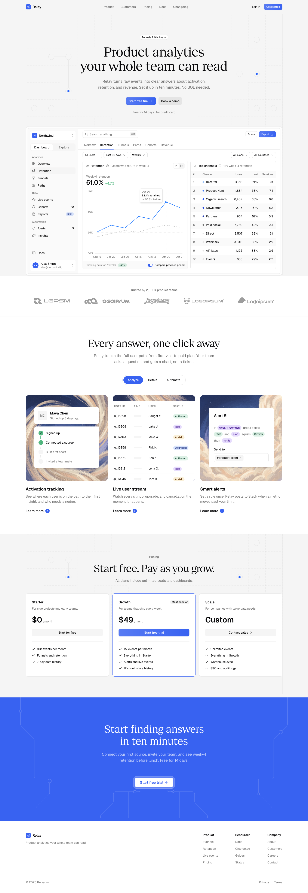

# Relay — SaaS Landing Page

A pixel-faithful implementation of the **"Landing / Relay — Geist Sans + Serif"** design
(shadcn/ui Design System by ReUI community file), built design-to-code with browser-verified
visual parity against the Figma frame.



## Stack

- **Vite 8** + **React 19** + **TypeScript**
- **Tailwind CSS 4** + **shadcn/ui** (Base UI preset)
- **Geist Sans** (Fontsource variable) + **Geist Serif** (Vercel `geist` woff2)
- **DialKit** — live tuning panel for the animated hero pattern
- **Lucide** icons

## Sections

Header · Hero (+ live product mockup) · Social proof · Features · Pricing · Final CTA · Footer

## Run it

```bash
bun install
bun run dev
```

Then open http://localhost:5173.

## Live hero pattern

The hero background pattern is animated — a shimmer wave across the grid, glowing packets
traveling the network links, breathing accent dots. Every parameter is tunable live via a
[DialKit](https://dialkit.dev) panel (bottom-right of the hero, dev builds only):

| Control | What it does |
| --- | --- |
| Speed | Scales every animation |
| Shimmer | Grid wave amplitude (0 = exact static Figma look) |
| Glow | Packet & halo intensity |
| Packets | Number of traveling dots (0–8) |
| Drift | Slow whole-pattern pan |
| Accent | Pulse color |
| Pause | Freeze all motion |

`prefers-reduced-motion` users get the static design automatically.
Tuned values can be copied from the panel and baked into
`src/components/landing/HeroPattern.tsx` defaults.

## Design source

- Extracted spec + Figma reference captures live in `design/`
- Decorative layers (patterns, logos, chart) were exported from Figma as SVG/PNG assets
- Implementation target: Figma node `44722:64571` — "Landing / Relay — Geist Sans + Serif"
  in the *shadcn/ui — Design System by ReUI (Community)* file

## Scripts

```bash
bun run dev        # start dev server
bun run build      # typecheck + production build
bun run lint       # eslint
bun run typecheck  # tsc --noEmit
```
